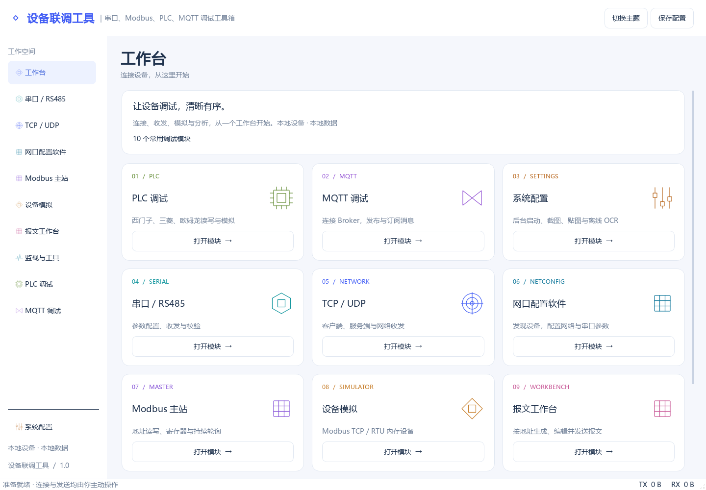
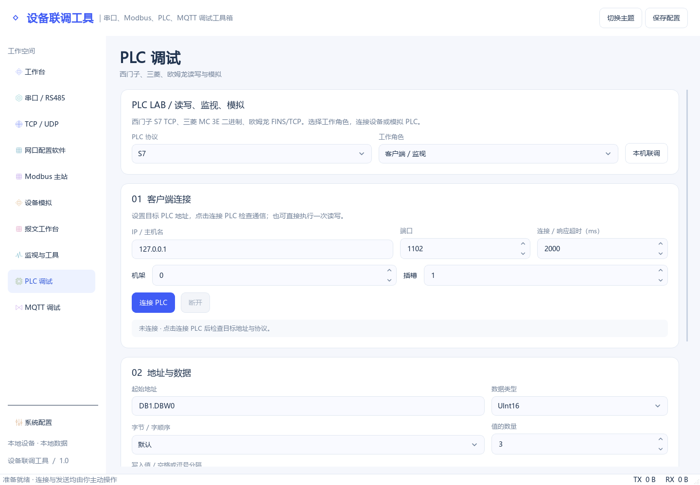
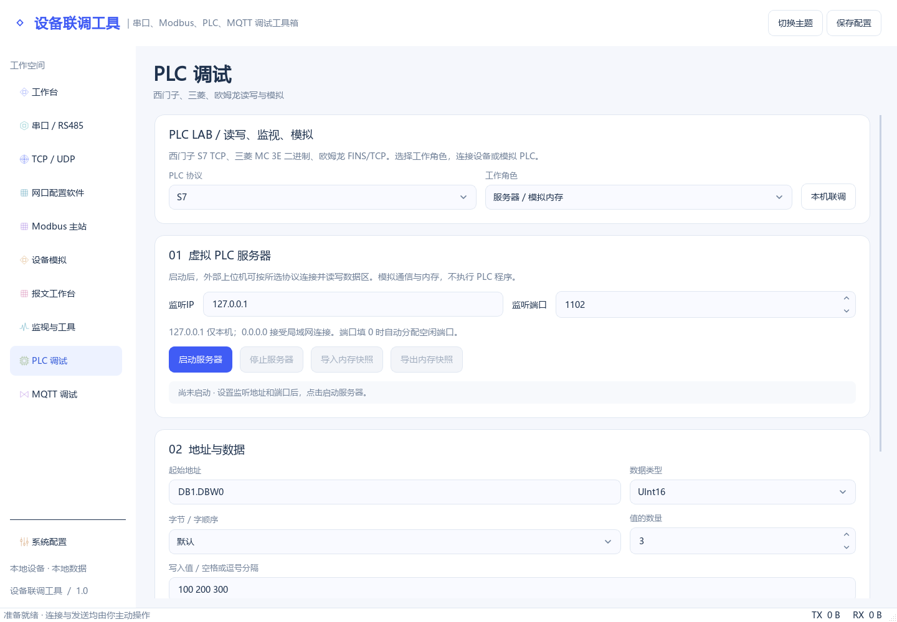
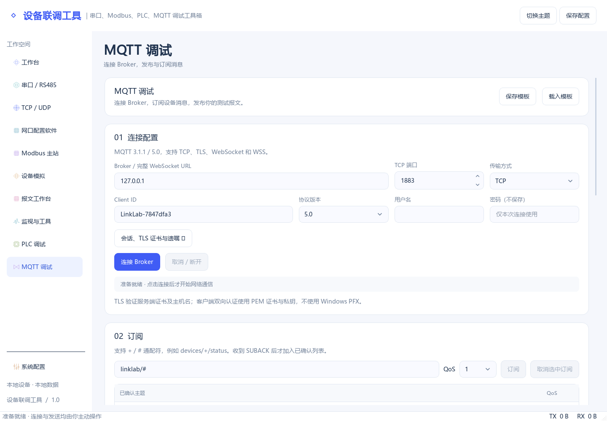
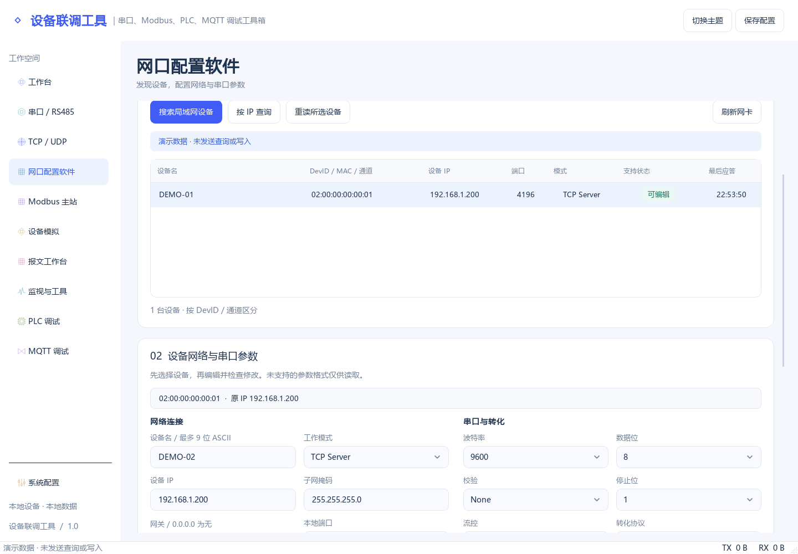
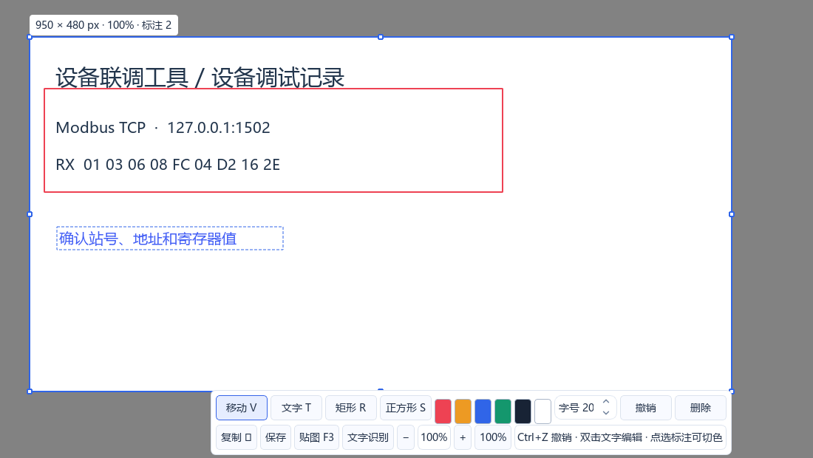

[简体中文](README.md) | **English** · [Repository](../README.en.md)

# Device Debug Tools | Serial, Modbus, PLC & MQTT Debugging Toolbox

The Python Qt edition of **Device Debug Tools** (设备联调工具) is implemented with **Python and PySide6 / Qt Widgets** for Ubuntu and is also runnable on Windows. Current version: **1.0**. Light theme by default, optional dark theme, and System settings pinned at the bottom. Serial, Modbus and PLC protocols are independent implementations; MQTT uses Eclipse Paho. No HslCommunication or paid vendor DLL is required.



## Features

| Module | Capabilities |
| --- | --- |
| Serial / RS485 | Port discovery and serial parameters, HEX/UTF-8/ASCII, CRC16-Modbus/CRC32/SUM/XOR/LRC, periodic sending, echo and fixed replies |
| TCP / UDP | TCP clients, multi-client servers, UDP, local binding and raw traffic |
| Modbus master / simulator | RTU/TCP, FC01/02/03/04/05/06/0F/10, reads/writes, polling, coil/register memory and byte-order conversion |
| PLC | S7 TCP, MC 3E binary, FINS/TCP, typed/bit reads and writes, monitoring, simulated servers, local loopback and memory snapshots |
| MQTT | 3.1.1/5.0, TCP/TLS/WS/WSS, QoS0/1/2, acknowledged subscriptions/publishing, retained messages, wills, reconnect, templates and exports |
| Device configuration | ZLAN UDP1092 discovery/query, network/serial settings, templates, target review, explicit writes and same-device readback |
| Frames / inspector | RTU/TCP generation, custom HEX, existing-connection sending, filtering, CSV/JSON export, parsing and conversion |
| System settings | Background startup, tray, F1 capture/selection/zoom/pan, colored text and rectangles/squares, undo, F3 pin zoom and local OCR |

Virtual serial remains hidden. Use existing `/dev/ttyUSB*`, `/dev/ttyACM*` or COM devices. Simulators provide protocol/memory access, not ladder execution.

<details>
<summary>Screenshots</summary>











</details>

## Setup and run

Intended for Ubuntu **22.04 / 24.04 x64**, Python **3.10–3.13**. Actual verification was performed on Windows / Python 3.12; Ubuntu desktop/hardware validation is pending.

From the repository root, with network access for initial dependencies:

```bash
sudo apt update
sudo apt install python3-venv python3-pip libxcb-cursor0 libxkbcommon-x11-0 libegl1 libopengl0 fonts-noto-cjk tesseract-ocr tesseract-ocr-eng tesseract-ocr-chi-sim
bash linux_ubuntu/scripts/setup.sh
bash linux_ubuntu/scripts/run.sh
```

For serial access, add your user to `dialout`, then sign out and back in:

```bash
sudo usermod -aG dialout "$USER"
```

The application does not need to run as root. Low listener ports such as 102/502 may require system privileges; local loopback uses higher or ephemeral ports.

For Windows source testing with Python 3.10–3.13:

```powershell
.\linux_ubuntu\scripts\setup.ps1 -Python C:\path\to\python.exe
.\linux_ubuntu\scripts\run.bat
```

After setup, double-click `scripts/run.bat` or invoke it from CMD. `.ps1` files require PowerShell rather than direct execution in CMD. Use `run.bat --debug` to keep startup errors visible, or `run.bat --background` to start in the tray.

Alternatively, run `.venv/Scripts/python.exe main.py` inside `linux_ubuntu/` (Ubuntu: `.venv/bin/python main.py`). `--background` starts in the tray when available, otherwise keeps a window. A second launch activates the existing Qt instance for the same user/desktop session.

## Usage notes

- **UI controls**: Dropdowns mark the selected option and show full text on hover. Scrolling over an unfocused dropdown does not change its value. Drag table headers to resize columns; narrow windows scroll within the table, and colored badges distinguish states.
- **PLC roles**: Use the top dropdown to choose client/monitoring or server/simulated memory. In server mode, set the listening IP and port, start the server, then read or write its memory. Switch back to the client to connect to the same simulator. Role selection starts no communication; switching to the server stops client polling.
- **Connect PLC**: The client button opens a real connection and verifies S7/FINS handshakes; MC 3E reports TCP connectivity. Connection failures show the endpoint and reason beside the controls. Adjust the timeout and retry if needed. Connecting does not read or write PLC memory. Changing connection parameters releases the old connection; read/write actions can still connect on demand.
- **Without hardware:** choose a PLC protocol and press “本机联调”. For Modbus, start the TCP simulator, then connect the master to its port. Avoid enabling echo on both ends of the same connection.
- **Capture:** enable current shortcuts in System settings. F1 supports selections across monitors with different scale factors; drag the selection/handles, use the wheel to zoom and Space/middle-drag to pan. T adds text, R rectangles, S squares; colors are editable. Windows exports native screen pixels; changing the monitor layout cancels the current capture. Copy/save/pin include marks; OCR reads the original selection. F3 pins support wheel zoom and Ctrl+wheel opacity.
- **Desktop differences:** global F1/F3 support Windows and X11 with conflict detection. Wayland restrictions are shown, not bypassed. If shortcuts or desktop capture are unavailable, use your system capture tool, then pin its clipboard image or open an image for OCR. Tray visibility depends on desktop support/extensions.
- **OCR:** Ubuntu uses local Tesseract and installed languages. Windows uses a local Tesseract installation or this repository's Windows native DLL/models. No image upload.
- **MQTT:** an external Broker is required. TLS validates the certificate and hostname using system trust or a supplied CA. Client authentication uses PEM certificate/key files, not PFX. Templates omit connection/private-key passwords.
- **Device configuration:** ZLAN's public protocol only. The 167-byte parameter baseline is writable; other recognized versions are read-only. Review DevID/channel and original IP before confirming a write/reboot. Failed readback never automatically repeats the write. PC adapter settings are not changed.
- **Preferences:** `%LOCALAPPDATA%/LinkLabQt/` on Windows, `$XDG_CONFIG_HOME/LinkLabQt/` on Linux (default `~/.config/LinkLabQt/`), separate from WPF. Startup does not connect/send automatically; autostart and capture defaults initially remain off.

## Test and package

```bash
bash linux_ubuntu/scripts/test.sh
python3 scripts/package-source.py
```

Windows provides `linux_ubuntu/scripts/test.ps1`. Generated results go to `linux_ubuntu/artifacts/`; the combined source ZIP goes to `windows/artifacts/LinkLab-1.0-all-platforms-source.zip`. See [verification notes](docs/testing.en.md).

The only Git ignore file is at the repository root, covering both platforms' build output, virtual environments, caches, logs, archives, secrets and local AI notes while retaining public documentation, screenshots and licenses.

See the [official Qt setup guide](https://doc.qt.io/qtforpython-6.8/gettingstarted.html) for Qt installation.

## License

Project-owned code is licensed under the [MIT License](LICENSE). Third-party dependencies, models and runtimes remain subject to their respective licenses; see [third-party notices](THIRD-PARTY-NOTICES.md).
