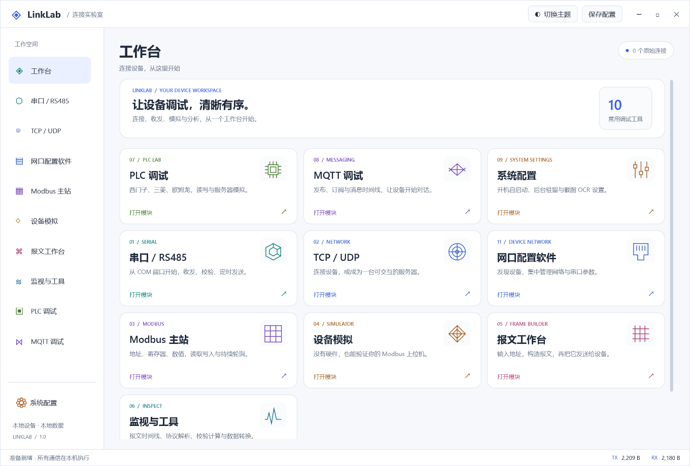
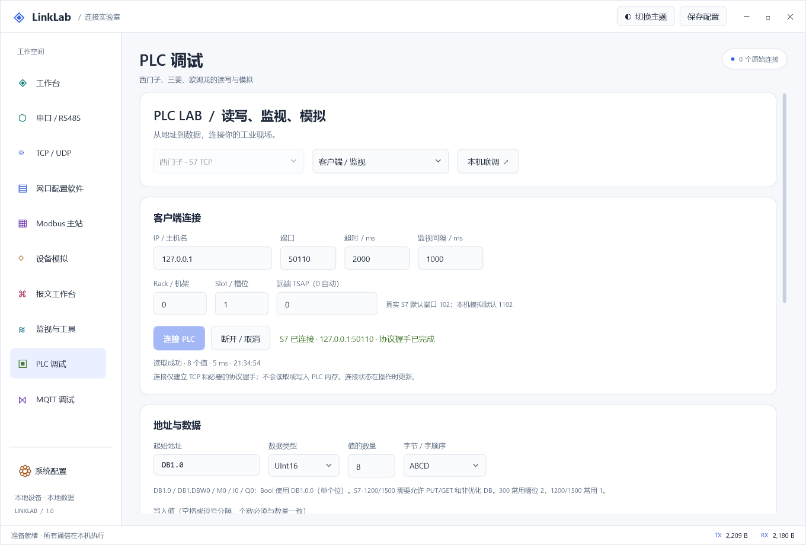
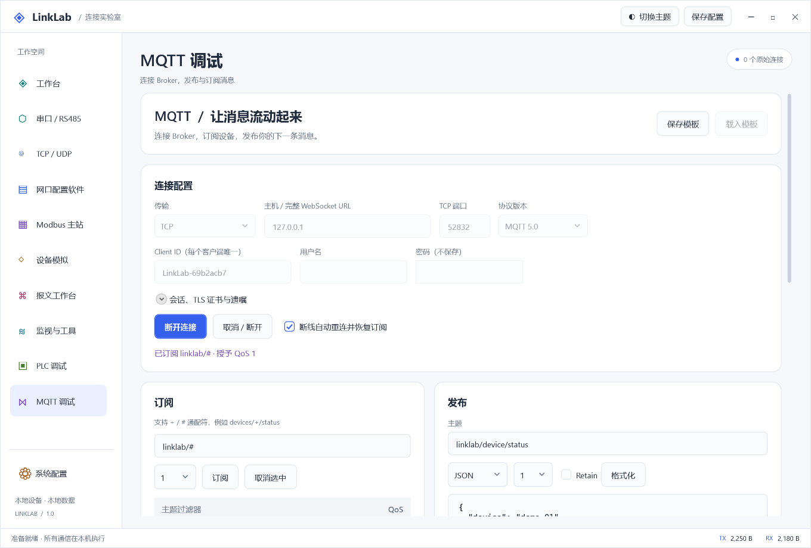
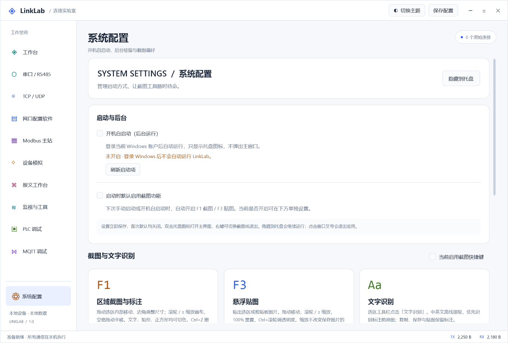
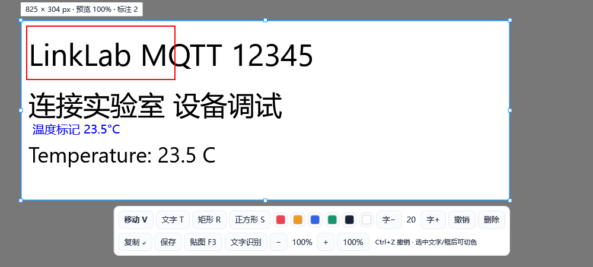
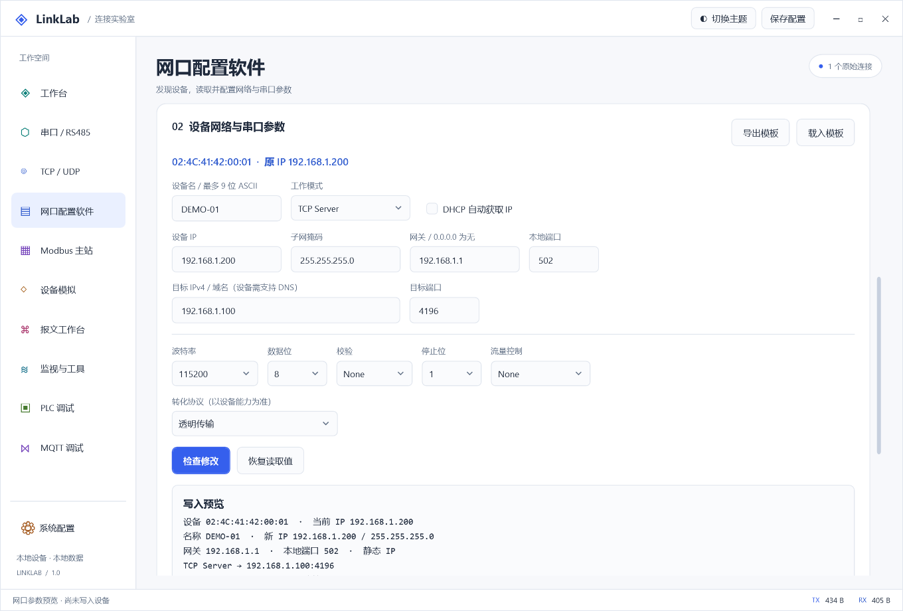

[简体中文](README.md) | **English**

# LinkLab

This is the `windows/` subproject. [Repository overview](../README.en.md) · [Ubuntu / Python Qt edition](../linux_ubuntu/README.en.md). Documentation lives in `windows/docs/`, generated output in `windows/artifacts/`, and shared Git exclusions in the repository root `.gitignore`.

A Windows desktop toolkit for industrial communication, embedded systems, and IoT development. Debug serial ports, networks, Modbus, PLCs, and MQTT, with screenshot and OCR utilities in the same workspace.

Built with **.NET 10 + WPF + MVVM**. Light theme by default, with a dark theme available. Current version: **1.0**. The application UI is currently in Chinese.



## Features

| Module | Capabilities |
| --- | --- |
| Serial / RS485 | COM settings, HEX / UTF-8 / ASCII messaging, periodic sending, CRC16-Modbus, CRC32, SUM, XOR, and LRC checksums |
| TCP / UDP | TCP client and multi-client server, UDP messaging, echo and fixed replies |
| Device network configuration | ZLAN broadcast discovery and IP queries, network/serial settings, import/export templates, and readback verification after writing |
| Modbus master | RTU / TCP, function codes 01/02/03/04/05/06/0F/10, register reads/writes, polling, and byte-order conversion |
| Device simulator | Modbus TCP server and RTU slave, editable coil and register memory |
| Frame builder | Generate frames from addresses, function codes, and values; edit HEX, send through an existing serial/network connection, and save templates |
| Monitor & tools | Traffic timeline, filtering, frame inspection, checksums, number conversion, and CSV / JSON export |
| PLC debugging | Siemens S7 TCP, Mitsubishi MC 3E binary, and Omron FINS/TCP; client reads/writes, polling, server simulation, and memory snapshots |
| MQTT debugging | MQTT 3.1.1 / 5.0, TCP / TLS / WS / WSS, QoS 0/1/2, publish/subscribe, retained messages, last will, reconnect, and connection templates |
| System settings | Background launch at sign-in, capture preferences and tray; F1 selection movement/resizing, zoom, colored text and rectangle/square annotations, F3 image zoom, and offline Chinese / English OCR |

<details>
<summary>More screenshots: PLC / MQTT / Device network configuration / System settings</summary>

**PLC debugging**



**MQTT debugging**



**System settings, capture, and offline OCR**





**Device network configuration**



</details>

## Requirements

| Scenario | Requirements |
| --- | --- |
| Run the portable build | Windows 10 / 11 x64. Self-contained packages include the .NET runtime; no separate .NET installation is needed |
| Use OCR | [Microsoft Visual C++ x64 Redistributable](https://learn.microsoft.com/en-us/cpp/windows/latest-supported-vc-redist). Chinese and English models are included; no model download is needed |
| Use serial / RS485 | An available COM device and the appropriate USB-to-serial / RS485 driver |
| Build from source | Windows and the [.NET 10 SDK](https://dotnet.microsoft.com/en-us/download/dotnet/10.0). Use PowerShell 7+ for project scripts; initial package restore requires NuGet access |

## Quick start

**Portable build:** Extract `LinkLab-<version>-win-x64.zip` and run `LinkLab.exe` inside the extracted folder. Keep the entire folder together.

**Run from source:** First enter the `windows/` project directory, then execute:

```powershell
dotnet restore LinkLab.sln
dotnet build LinkLab.sln -c Release -m:1
dotnet run --project src/LinkLab.App -c Release --no-build
```

Run tests and create a Windows x64 portable package:

```powershell
.\scripts\build.ps1 -RunTests
.\scripts\publish.ps1
```

Build outputs are placed in `artifacts/`. To try PLC reads/writes without hardware, open **PLC 调试 → 本机联调** (PLC debugging → local loopback).

## Usage notes

- Set the PLC client address and port, then click **连接 PLC** (Connect PLC). S7/FINS handshakes are verified; MC 3E reports TCP connectivity. Failures appear beside the connection controls, and the timeout can be adjusted before retrying. Connecting does not read or write PLC memory; read/write actions can still connect on demand.
- PLC simulators implement communication and memory access, not ladder logic. S7-1200/1500 requires PUT/GET access and non-optimized DBs. Device models, firmware, and serial timing still require hardware validation.
- MQTT debugging requires an external broker. Connection and client-certificate passwords are excluded from saved templates.
- Device network configuration implements ZLAN's published UDP management protocol and is not a universal configuration utility for every vendor. Discovery runs only on request; writing requires reviewing the target and confirming. See the [network configuration guide](docs/network-config.en.md) for supported formats and usage.
- The virtual serial module is temporarily hidden; this release does not require com0com. Serial / RS485 and Modbus RTU continue to work with existing COM devices.
- **系统配置** (System settings) is pinned to the bottom of the sidebar. Its independent launch-at-sign-in and capture-on-start options are both off initially and saved immediately. Automatic launch stays in the tray; double-click to restore the window or use the tray menu to exit. After upgrading or moving the app, update the startup entry to the current version.
- The current capture switch is independent of the next-start preference; F1/F3 conflicts are reported. OCR runs locally without uploading images. See [system settings](docs/system-settings.en.md) for background operation and startup details.
- Settings are stored in `%LOCALAPPDATA%\LinkLab\settings.json`. Startup does not automatically connect to devices or send data.

## Dependencies

PLC communication uses [IoTClient](https://github.com/zhaopeiym/IoTClient), MQTT uses [MQTTnet](https://github.com/dotnet/MQTTnet), and OCR uses [Tesseract .NET](https://github.com/charlesw/tesseract) with offline models. No HslCommunication DLL is referenced.

See [THIRD-PARTY-NOTICES.md](THIRD-PARTY-NOTICES.md) and [licenses/](licenses/) for component notices and licenses.
